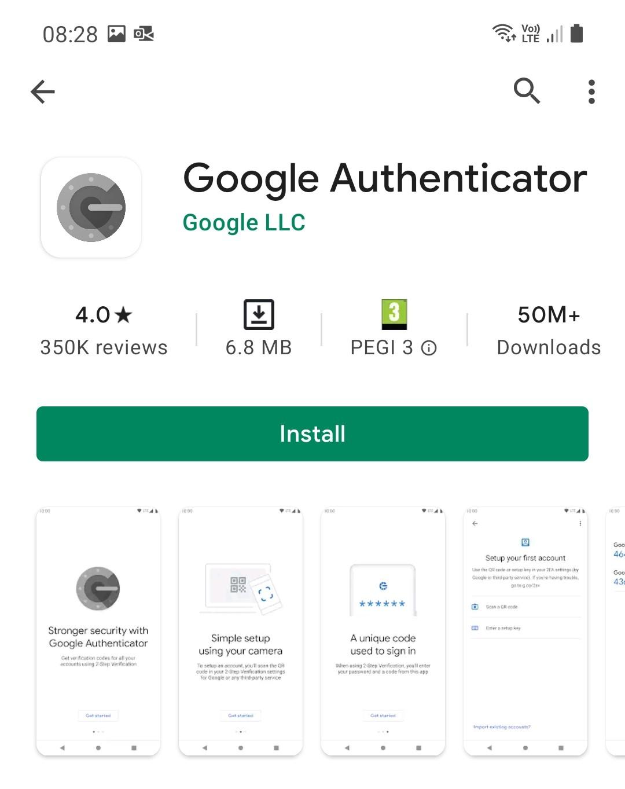
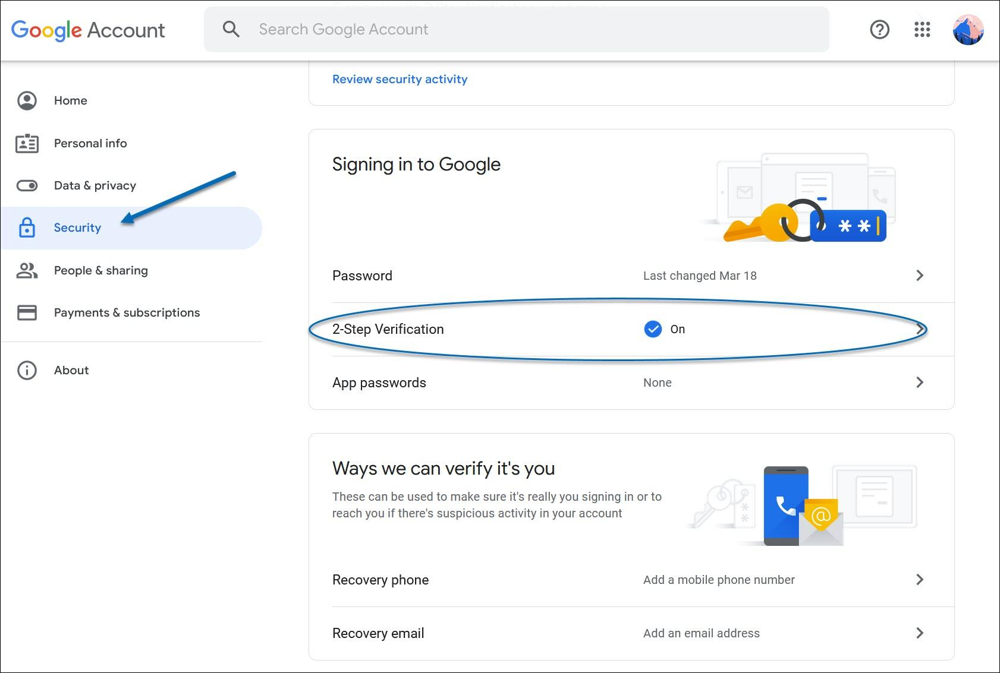
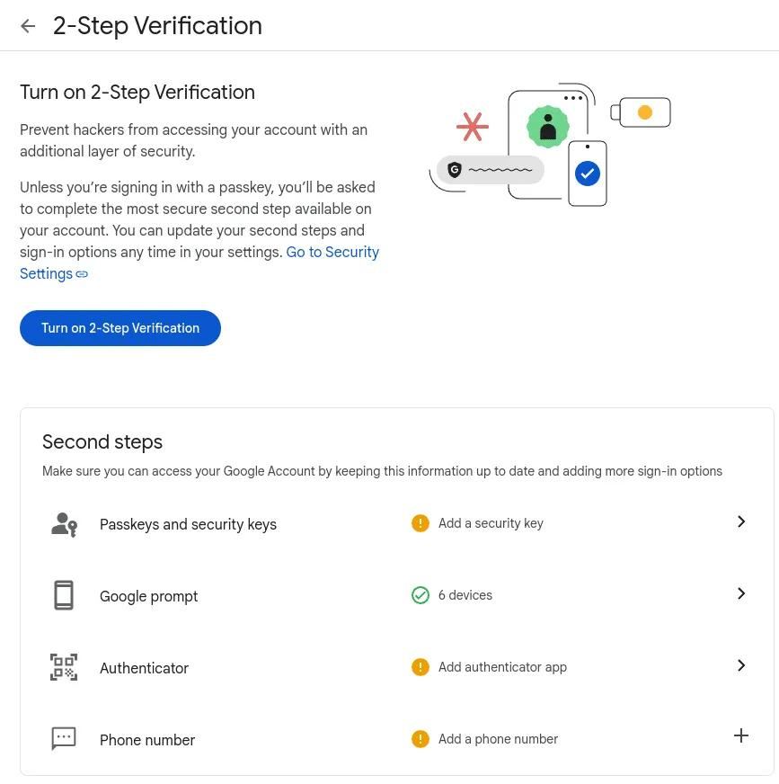
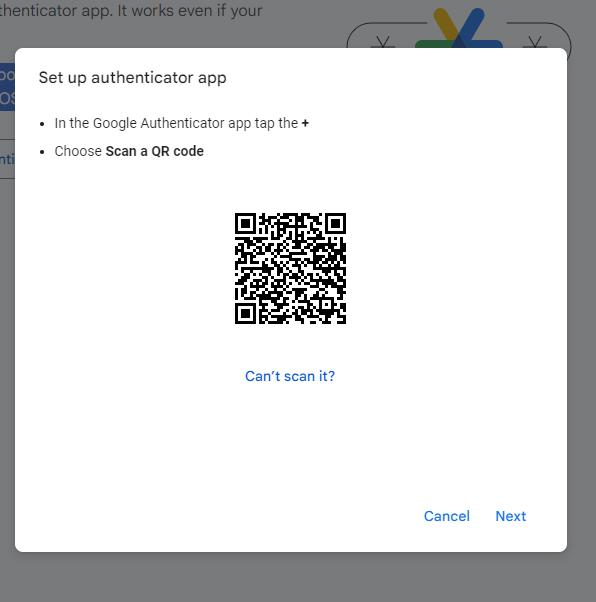
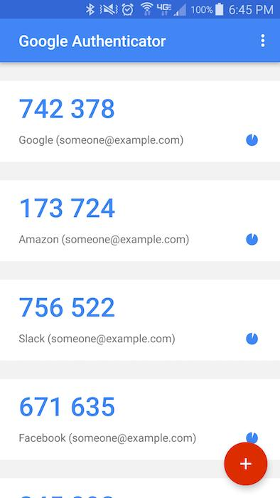
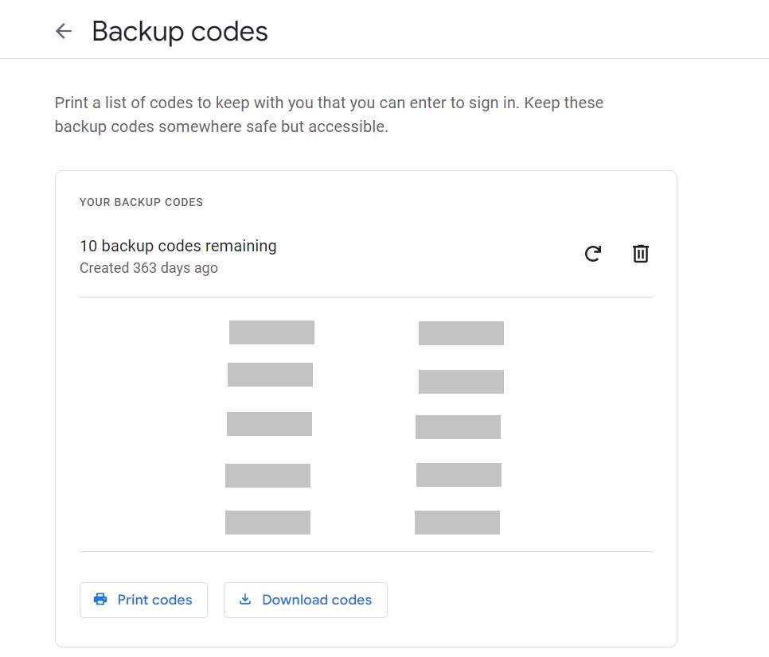
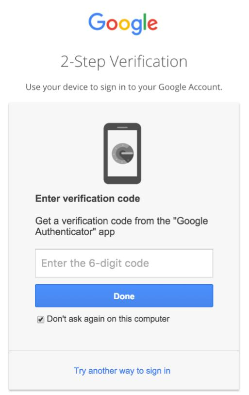

# NF1AA3 – Autenticació multifactor (MFA)

## Guia d'usuari: Configuració de l'autenticació multifactor amb Google Authenticator

**Activitat:** NF1AA3 – Autenticació multifactor  
**Objectiu:** Protegir els comptes corporatius mitjançant la verificació en dos passos.

---

# Guia d'instal·lació i configuració de l'autenticació multifactor (MFA)

## 1. Introducció

L'autenticació de dos factors (2FA/MFA) afegeix una capa addicional de protecció als nostres comptes. En comptes de dependre només d'una contrasenya, requereix un segon element de verificació (com un codi dinàmic al mòbil). Això evita accessos no autoritzats tot i que algú descobreixi la teva contrasenya.

---

## 2. Requisits previs

* [x] Ordinador amb connexió a Internet.
* [x] Dispositiu mòbil (Android o iOS).
* [x] Compte corporatiu de Google (`@mataro.epiaedu.cat`).
* [x] Aplicació **Google Authenticator** instal·lada.

---

## 3. Instal·lació de Google Authenticator

1. Obrim la botiga d'aplicacions del telèfon mòbil:
   * **Android:** [Google Play](https://play.google.com/store/apps/details?id=com.google.android.apps.authenticator2)
   * **iOS (iPhone):** [App Store](https://apps.apple.com/app/google-authenticator/id388497605)
2. Cerquem l'aplicació **Google Authenticator**.
3. Instal·lem i obrim l'aplicació per deixar-la a punt.

*Figura 1. Instal·lació de Google Authenticator.*

---

## 4. Accés a la seguretat de Google

1. Obrim el navegador a l'ordinador i entrem al nostre correu corporatiu.
2. Comprovem que estem fent servir el compte `@mataro.epiaedu.cat` correcte.
3. Enllacem amb la [Configuració de seguretat de Google](https://myaccount.google.com/security).
4. Localitzem l'apartat **«Com s'inicia la sessió a Google»**.

*Figura 2. Panell de seguretat del compte.*

---

## 5. Activació de la verificació en dos passos

1. Fem clic a **«Verificació en dos passos»** i tornem a introduir la contrasenya si se'ns sol·licita.
2. Completem els passos de l'assistent per vincular el telèfon mòbil.
3. Un cop activa la verificació, seleccionem l'opció per afegir una aplicació d'autenticació.

*Figura 3. Procés d'activació del 2FA.*

---

## 6. Vinculació amb Google Authenticator

1. Seleccionem **«Aplicació Authenticator»** a la pantalla de l'ordinador per veure el codi QR.
2. Obrim **Google Authenticator** al mòbil, premem el botó d'afegir compte (`+`) i triem **«Escanejar un codi QR»**.
3. Apuntem amb la càmera del mòbil cap al codi QR de l'ordinador.
4. L'aplicació afegirà el compte automàticament i començarà a generar codis temporals de 6 dígits.
5. Introdueix a l'ordinador el codi que apareix a l'aplicació abans que caduqui per confirmar l'enllaç.

*Figura 4. Escaneig del codi QR.*

---

## 7. Comprovació dels codis temporals

Una vegada vinculat, **Google Authenticator** generarà claus numèriques de 6 dígits que s'actualitzen periòdicament. Per validar qualsevol sessió:

1. Obrim l'aplicació al mòbil.
2. Cerquem el compte corporatiu associat.
3. Copiem o escrivim el codi actiu a la pantalla de verificació de Google.

*Figura 5. Vista dels codis temporals a l'aplicació.*

---

## 8. Generació de codis de reserva

Aquests codis et permetran accedir al compte en cas de perdre el mòbil o quedar-te sense bateria.

1. Tornem a l'apartat **«Verificació en dos passos»** de Google.
2. Cerquem i entrem a l'opció **«Codis de seguretat»**.
3. Generem la llista de **10 codis d'un sol ús**.
4. Descarreguem o imprimim els codis i els guardem en un lloc segur i independent del mòbil.

> ⚠️ **Recomanació:** No compartiu mai els codis de seguretat amb ningú i conserveu-los en un lloc protegit.

*Figura 6. Obtenció dels codis de suport.*

---

## 9. Prova de funcionament

1. Tanquem la sessió actual del compte de Google.
2. Tornem a iniciar sessió amb el correu i la contrasenya.
3. Quan es demani el segon factor de verificació, triem l'opció d'utilitzar l'aplicació d'autenticació.
4. Obrim **Google Authenticator** i escrivim el codi de 6 dígits actual.
5. Confirmem que l'accés s'ha realitzat correctament.

*Figura 7. Validació del segon factor en iniciar sessió.*

---

## 10. Bones pràctiques de seguretat

* Utilitzar una contrasenya robusta i única per al compte corporatiu.
* No compartir mai ni els codis temporals ni el codi QR inicial.
* Mantenir el telèfon protegit amb PIN, contrasenya o lectura biomètrica.
* Desar els codis de reserva fora del dispositiu mòbil.
* Mantenir actualitzats el sistema operatiu i l'aplicació d'autenticació.
* Notificar immediatament al departament d'IT en cas de pèrdua o sospita d'accés no autoritzat.

---

## 11. Conclusió

La implantació de l'autenticació multifactor amb Google Authenticator millora dràsticament la seguretat dels comptes corporatius, garantint que la contrasenya per si sola no sigui suficient per accedir-hi.

---

**Fi de la guia – NF1AA3**